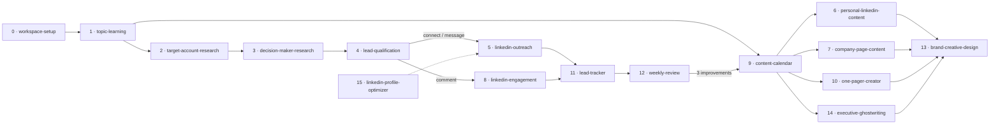

# LinkedIn B2B Growth Skills

**16 Claude skills that run an evidence-based LinkedIn B2B marketing and lead-generation system:** learn the topic, find the right accounts and people, write posts, comments and outreach, plan campaigns, track a pipeline and review results every week.

Works in **Claude Code** (as a plugin) and **Claude.ai / Cowork** (as uploaded skills).

[](https://github.com/pratham7788saxena-web/linkedin-b2b-growth-skills/actions/workflows/validate.yml)

---

## Why this exists

Most "AI for LinkedIn" tools generate volume: 30 posts, 100 connection requests, generic comments. In B2B, where the buyer is a handful of senior people at a few dozen companies, volume backfires.

This system does the opposite. It was built and refined while running real B2B LinkedIn campaigns for a technology services company, by a marketer learning a highly technical field. Every skill follows the same rules:

- **Teach before you market.** Understand the topic in plain English first.
- **Evidence over assumption.** Every claim is labelled `[VERIFIED]`, `[INDUSTRY]` or `[ASSUMPTION]`, with sources and dates.
- **Never invent.** No made-up people, titles, customers, results or pain points.
- **Humans send everything.** No bots, scrapers or auto-connect tools. It respects LinkedIn's rules.
- **Relevance over volume.** A like or an accepted request is not a lead.
- **A closed loop.** Weekly reviews feed next week's plan.

## The system



| # | Skill | What it does | Stage |
|---|---|---|---|
| 0 | [`workspace-setup`](skills/workspace-setup/SKILL.md) | Audits your website, builds the verified company profile, creates the workspace and tracker | Set up |
| 1 | [`topic-learning`](skills/topic-learning/SKILL.md) | Explains any technical topic in plain English, maps it to buyers and your offering | Learn |
| 2 | [`target-account-research`](skills/target-account-research/SKILL.md) | Builds an ICP, finds companies with public evidence, scores them 0–12 | Find accounts |
| 3 | [`decision-maker-research`](skills/decision-maker-research/SKILL.md) | Maps the buying committee, finds and verifies people, includes a LinkedIn search playbook | Find people |
| 4 | [`lead-qualification`](skills/lead-qualification/SKILL.md) | Scores prospects and picks exactly one next action each | Qualify |
| 5 | [`linkedin-outreach`](skills/linkedin-outreach/SKILL.md) | Eight message types, from connection request to graceful close, with personalisation notes | Connect & nurture |
| 6 | [`personal-linkedin-content`](skills/personal-linkedin-content/SKILL.md) | Personal posts in a credible voice, including "learning in public" | Visibility |
| 7 | [`company-page-content`](skills/company-page-content/SKILL.md) | Company posts that answer five questions, with a claim table | Visibility |
| 8 | [`linkedin-engagement`](skills/linkedin-engagement/SKILL.md) | Explains a post, then drafts three comments that add value | Engage |
| 9 | [`content-calendar`](skills/content-calendar/SKILL.md) | Turns a campaign brief into a coordinated, non-repeating plan | Strategize |
| 10 | [`one-pager-creator`](skills/one-pager-creator/SKILL.md) | One-pagers, solution briefs, carousel outlines | Assets |
| 11 | [`lead-tracker`](skills/lead-tracker/SKILL.md) | Spreadsheet CRM with 11 evidence-based stages and a daily follow-up list | Track |
| 12 | [`weekly-review`](skills/weekly-review/SKILL.md) | Separates activity, engagement, lead and business metrics; three improvements | Improve |
| 13 | [`brand-creative-design`](skills/brand-creative-design/SKILL.md) | On-brand post, carousel and banner design from your brand kit | Design |
| 14 | [`executive-ghostwriting`](skills/executive-ghostwriting/SKILL.md) | Leader posts with voice capture and written approval for every post | Visibility |
| 15 | [`linkedin-profile-optimizer`](skills/linkedin-profile-optimizer/SKILL.md) | Audits and rewrites profiles and company pages | Foundation |

## Install

### Claude Code (plugin)

```text
/plugin marketplace add YOUR-USERNAME/linkedin-b2b-growth-skills
/plugin install linkedin-b2b-growth@linkedin-b2b-growth-skills
```

Or copy the skills folder in by hand:

```bash
git clone https://github.com/YOUR-USERNAME/linkedin-b2b-growth-skills.git
# for every project:
cp -r linkedin-b2b-growth-skills/skills/* ~/.claude/skills/
# or for one project only:
cp -r linkedin-b2b-growth-skills/skills/* your-project/.claude/skills/
```

### Claude.ai / Cowork

```bash
pip install -r scripts/requirements.txt
python scripts/package_skills.py   # writes dist/<skill>.zip
```

Upload each zip in **Settings → Capabilities → Skills**. Skills must be enabled on your plan.

## Quick start

1. Create a folder for your marketing work and open Claude in it.
2. Say: **"Set me up. Our website is example.com and our LinkedIn page is linkedin.com/company/example."**
   `workspace-setup` audits the site and creates `linkedin-workspace/` with your company profile, logs and lead tracker.
3. Copy [`templates/CLAUDE.md.example`](templates/CLAUDE.md.example) to `CLAUDE.md` so every session reads the workspace first.
4. Then just ask in plain words:
   - "Teach me what revenue operations (RevOps) is and how it relates to us."
   - "Find 8 mid-size logistics firms in Germany that might need our route-planning software."
   - "Who should I contact at Company X? Here are the search results I copied."
   - "Here's a post from a CTO. Explain it and give me three comments."
   - "Plan the next 4 weeks of LinkedIn content for this campaign."
   - "Weekly review: 14 requests sent, 8 accepted, 2 replies, 0 meetings."

More in [docs/getting-started.md](docs/getting-started.md) and a full fictional walkthrough in [examples/walkthrough.md](examples/walkthrough.md).

## The workspace (your private memory)

Skills don't remember past conversations. The workspace does.

```
linkedin-workspace/          ← git-ignored: contains prospect data
├── company-profile.md       verified facts, approved claims, traps, approvers
├── campaign-log.md          briefs, decisions, weekly lessons
├── content-log.md           what's published, hooks already used
├── voice-notes.md           how you (and your executive) write
├── brand-kit.md             colours, fonts, logo rules, post frame
├── topic-notes/             one learning note per topic
├── account-research/        one file per company
└── lead-tracker.xlsx        Leads, Accounts, Activity Log, Weekly Metrics, Content Calendar, Stages
```

## Repository layout

```
.claude-plugin/        plugin.json + marketplace.json (Claude Code)
skills/<name>/         SKILL.md + references/ (+ assets/)
shared/                ground-rules.md: single source, copied into every skill
templates/             workspace starter files and CLAUDE.md example
scripts/               build_tracker_template.py · sync_shared.py · validate_skills.py · package_skills.py
docs/                  getting started, methodology, customising, daily routine
examples/              fictional end-to-end walkthrough
.github/workflows/     CI: validate skills and shared-file sync on every push
```

## Customise it

See [docs/customizing.md](docs/customizing.md): change the scoring weights, stages, tone, weekly volumes, or add your industry's roles and sources. Edit `shared/ground-rules.md`, then run `python scripts/sync_shared.py`.

## Responsible use

These skills help you **research and write**. You stay in control of every action on LinkedIn. They are designed to:

- use only information people made public for professional purposes;
- never collect personal emails or phone numbers;
- never automate connections, messages, likes or scraping;
- keep prospect data in your own local files.

Follow LinkedIn's [User Agreement](https://www.linkedin.com/legal/user-agreement) and [Professional Community Policies](https://www.linkedin.com/legal/professional-community-policies), and your local privacy law (e.g. GDPR).

## Contributing

Issues and pull requests are welcome. See [CONTRIBUTING.md](CONTRIBUTING.md).

## Author

Built by **Pratham Saxena**: B2B marketer and builder of AI-assisted marketing systems.
[LinkedIn](https://www.linkedin.com/in/YOUR-LINKEDIN) · [GitHub](https://github.com/YOUR-USERNAME)

## License

[MIT](LICENSE)
